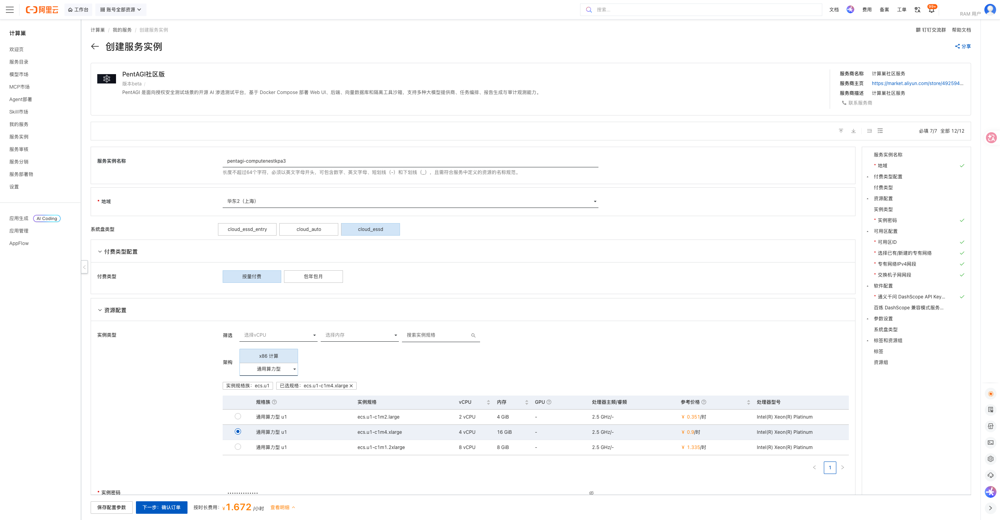
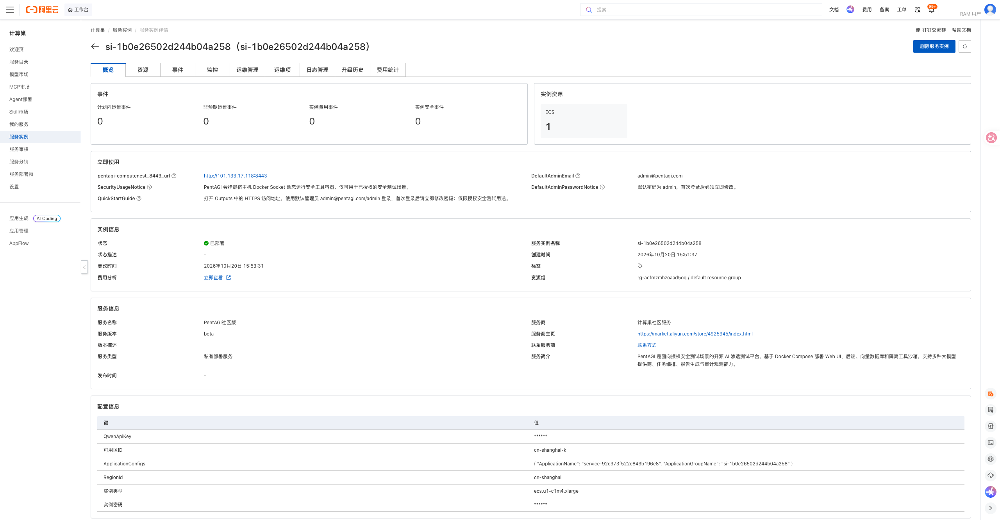
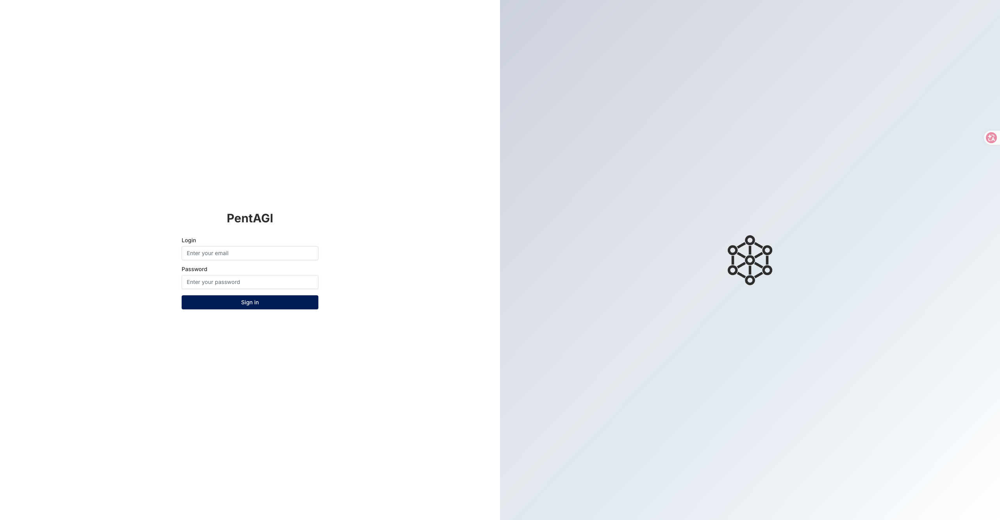

# PentAGI 计算巢部署文档

## 概述

[PentAGI](https://github.com/vxcontrol/pentagi) 是面向授权安全测试场景的开源 AI 渗透测试平台，基于 Docker Compose 部署 Web UI、后端、向量数据库与隔离工具沙箱，支持多种大模型，提供任务编排、报告生成与审计观测能力。本方案将其部署在用户自己的 ECS 中。仅可用于已获书面授权的安全测试。

| 项目 | 说明 |
| --- | --- |
| 服务 ID | `service-92c373f522c843b196e8` |
| 部署形态 | 单台 ECS + Docker Compose |
| 访问方式 | 公网 HTTPS 访问（首次打开需信任自签名证书） |
| 应用端口 | 8443（Web UI，HTTPS） |
| 实测部署耗时 | 约 2 分钟 |

## 部署步骤

### 1. 打开创建页面

访问 [PentAGI 服务实例创建页](https://computenest.console.aliyun.com/service/instance/create/cn-hangzhou?type=user&ServiceId=service-92c373f522c843b196e8)。

### 2. 配置部署参数

| 参数 | 说明 | 建议 |
| --- | --- | --- |
| 服务实例名称 | 控制台中用于识别本次部署 | 保持默认或自定义 |
| 地域、可用区 | ECS 所在位置 | 选择接近使用者且有库存的地域和可用区 |
| 付费类型 | 按量付费或包年包月 | 测试使用按量付费 |
| 实例类型 | ECS 规格 | 提供 3 种通用算力型 u1 规格 |
| 通义千问 DashScope API Key | PentAGI 调用大模型能力的密钥 | 填入你自己的有效 Key，用量消耗对应额度 |
| 实例密码 | ECS 登录密码 | 使用符合页面规则的强密码 |
| 专有网络 | 新建或复用 VPC | 首次部署可选择新建 |
| VPC/交换机网段 | 网络地址范围 | 无冲突时保持默认 |
| 系统盘类型 | ECS 系统盘 | 默认 `cloud_essd` |

默认管理员为 `admin@pentagi.com` / `admin`，首次登录后请立即修改密码；请勿将密码写入文档或代码仓库。

填写完成并看到询价结果后，点击“下一步：确认订单”，核对资源和费用，勾选服务协议并创建实例。

### 3. 等待部署完成

进入服务实例详情页，等待状态变为“已部署”。本次实测从创建到部署完成约 2 分钟。

### 4. 进入应用

在实例详情页「立即使用」区域打开访问地址（PentAGI 为自签名 HTTPS，首次打开需在浏览器信任证书）。

打开 HTTPS 访问地址（自签名证书需在浏览器中信任），使用默认管理员 `admin@pentagi.com` / `admin` 登录并立即修改密码，配置模型服务后即可在授权范围内创建测试任务。

## 数据与安全

- PentAGI 会挂载宿主机 Docker Socket 动态运行安全工具容器，仅可用于已获书面授权的安全测试场景。
- 8443 为自签名 HTTPS，生产环境建议配置正规证书与反向代理。
- DashScope API Key 保存在你自己的实例中；任务与报告数据均在实例本地。

## 资源释放

不再使用时，在计算巢服务实例详情页执行“删除”。删除完成后建议继续确认：

1. 服务实例已不存在；
2. ROS 资源栈状态为 `DELETE_COMPLETE`；
3. ECS、VPC、交换机和安全组均无残留；
4. 账单中不再产生相关按量资源费用。

删除服务实例会同时删除 ECS 及其本地数据，请提前导出或备份重要文件和配置。

## 官方链接

- [PentAGI 官方仓库](https://github.com/vxcontrol/pentagi)
- [PentAGI 官方网站](https://pentagi.com/)

- [阿里云计算巢文档](https://help.aliyun.com/zh/compute-nest/)
